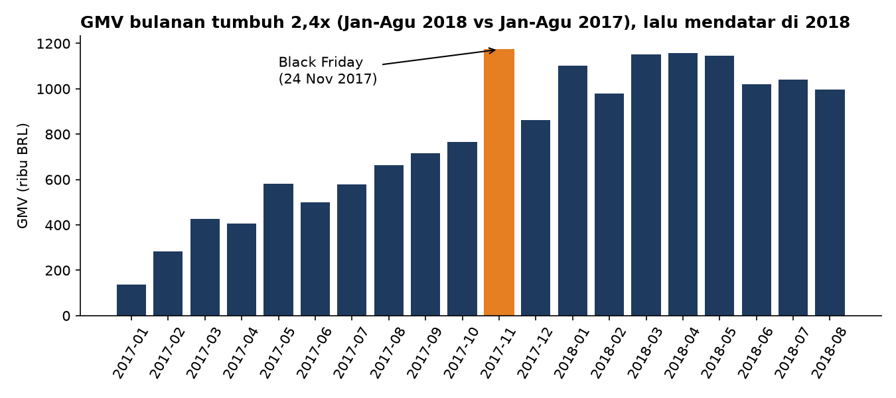
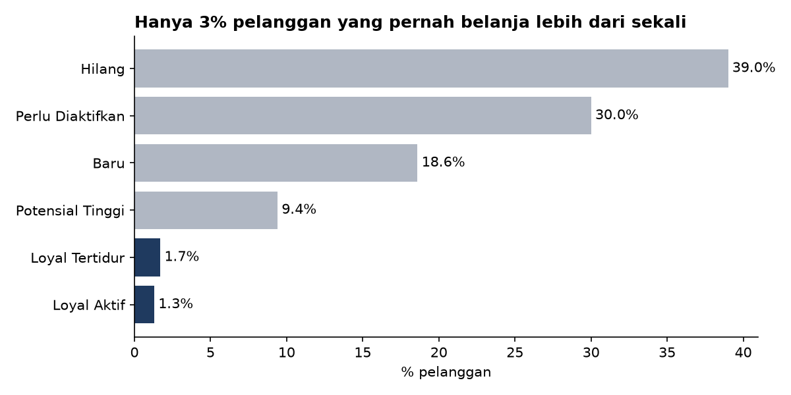
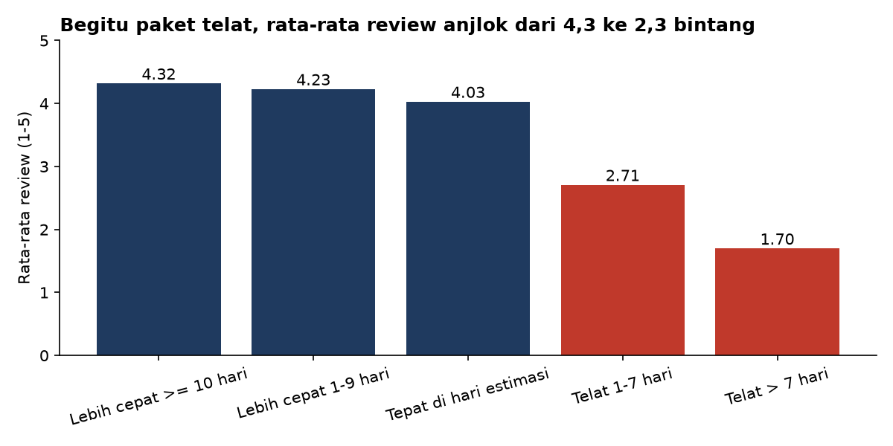
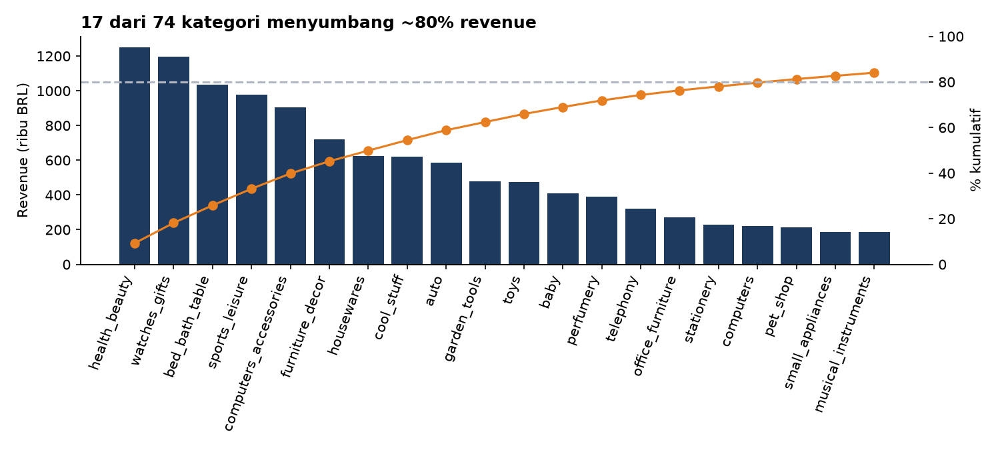

# Insight Report: Pertumbuhan Olist Tidak Diikuti Loyalitas

**Periode data:** Januari 2017 – Agustus 2018 · **Sumber:** Olist Brazilian E-commerce public dataset · **Mata uang:** BRL

## Ringkasan

Dalam 20 bulan, Olist tumbuh cepat. GMV Januari–Agustus 2018 sudah 2,4 kali GMV periode yang sama di 2017. Namun pertumbuhan ini hampir seluruhnya datang dari pelanggan baru: **hanya 3,04% pelanggan yang pernah belanja lebih dari sekali.** Sejak awal 2018 GMV bulanan juga mulai mendatar di kisaran 1,0–1,16 juta BRL. Artinya, mesin akuisisi saja tidak cukup lagi untuk mendorong pertumbuhan.

Faktor yang paling bisa dikendalikan dan berpengaruh besar ke kepuasan adalah **ketepatan pengiriman.** Order yang telat hanya 6,7% dari order terkirim, tapi menyumbang **sepertiga (32,6%) dari seluruh review bintang 1–2.**

| KPI (Jan 2017 – Agu 2018) | Nilai |
|---|---|
| Total order valid | 97.910 |
| Pelanggan unik | 94.707 |
| GMV | 15,69 juta BRL |
| AOV | 160,23 BRL |
| Porsi ongkir dalam GMV | 14,3% |
| Rata-rata review | 4,12 / 5 |
| Order telat dari estimasi | 6,8% |
| Rata-rata lama kirim | 12,5 hari |
| Pelanggan yang belanja ulang | 3,04% |

---

## Temuan 1: Tumbuh cepat di 2017, mendatar di 2018

- GMV naik hampir setiap bulan sepanjang 2017. Puncaknya November 2017: pada hari Black Friday (24 Nov) saja ada 1.166 order dalam satu hari.
- Sejak Januari 2018, GMV bulanan bergerak datar di 1,0–1,16 juta BRL. Juni–Agustus 2018 bahkan sedikit di bawah Maret–Mei.
- AOV relatif stabil di 146–175 BRL. Jadi kenaikan GMV datang dari **jumlah order**, bukan dari nilai belanja per order.

## Temuan 2: Hampir semua pelanggan hanya belanja sekali

- Dari pelanggan di periode analisis, hanya 3,04% yang punya 2 order atau lebih.
- Di setiap cohort bulanan, pelanggan yang kembali di bulan berikutnya **di bawah 1%.**
- Angka repeat yang sebenarnya kemungkinan lebih kecil lagi: 30% dari "pembelian kedua" terjadi di **hari yang sama** dengan pembelian pertama, yang kemungkinan besar adalah satu keranjang yang dipecah jadi dua order.
- Untuk yang benar-benar kembali, median jarak ke pembelian kedua adalah **28 hari.**
- Segmen **Potensial Tinggi** (8.868 pelanggan, 9,4%) cuma belanja sekali tapi nilainya besar (rata-rata 384 BRL), dan menyumbang **21,7% total belanja.** Segmen ini paling layak didekati lebih dulu.

| Segmen | % pelanggan | % nilai belanja | Rata-rata belanja (BRL) |
|---|---|---|---|
| Hilang (>270 hari, 1×) | 39,0% | 38,1% | 162 |
| Perlu Diaktifkan | 30,0% | 16,2% | 90 |
| Baru (≤90 hari) | 18,6% | 18,3% | 162 |
| Potensial Tinggi | 9,4% | 21,7% | 384 |
| Loyal Tertidur | 1,7% | 3,1% | 299 |
| Loyal Aktif | 1,3% | 2,5% | 321 |

## Temuan 3: Keterlambatan adalah pembunuh review

- Order yang tiba tepat waktu atau lebih cepat mendapat rata-rata review **4,29.** Order yang telat hanya **2,27.**
- Kalau telatnya lebih dari 7 hari, **79% review-nya bintang 1–2.**
- Order telat cuma 6,7% dari order terkirim, tapi menyumbang **32,6% dari semua review buruk.**
- Masalahnya terkonsentrasi di wilayah tertentu:

| Negara bagian | Order terkirim | Rata-rata hari kirim | % telat |
|---|---|---|---|
| MA (Maranhão) | 713 | 21,5 | 17,5% |
| CE (Ceará) | 1.273 | 21,2 | 13,8% |
| BA (Bahia) | 3.253 | 19,3 | 12,2% |
| **RJ (Rio de Janeiro)** | **12.310** | 15,2 | **12,1%** |
| SP (São Paulo), pembanding | 40.399 | 8,7 | 4,5% |

RJ paling perlu diperhatikan. Volumenya terbesar kedua, tapi tingkat telatnya hampir 3 kali SP.

## Temuan 4: Revenue sangat terkonsentrasi, tapi kualitas seller merata

- **17 dari 74 kategori** menyumbang ~80% revenue produk. Lima teratas: health_beauty, watches_gifts, bed_bath_table, sports_leisure, computers_accessories.
- **20% seller teratas (606 seller) menghasilkan 82,5% revenue.**
- Review dan tingkat telat hampir sama di semua kelompok seller (review 3,9–4,1, telat 6,7–7,6%). Jadi keterlambatan lebih terkait **rute dan wilayah tujuan** daripada seller tertentu.
- Di antara 20 kategori teratas, office_furniture punya review paling rendah (3,50).

---

## Rekomendasi

1. **Perbaiki pengiriman ke RJ dan wilayah Timur Laut (MA, CE, BA).** Evaluasi mitra kurir di rute ini, dan buat estimasi pengiriman lebih jujur untuk wilayah tersebut. Lebih baik janji 20 hari dan tiba di hari ke-18 daripada janji 15 hari dan telat. Dari data, order yang tiba lebih cepat dari estimasi selalu dapat review tinggi.
2. **Notifikasi proaktif + voucher kecil saat order diprediksi telat.** Order telat menyumbang sepertiga review buruk. Menahan sebagian saja dari itu sudah menaikkan rating toko secara keseluruhan.
3. **Kampanye pembelian kedua sekitar hari ke-25–30** setelah pembelian pertama, mengikuti median 28 hari. Mulai dari segmen Potensial Tinggi dan Baru.
4. **Program key account untuk 20% seller teratas.** Kehilangan sebagian kecil dari mereka langsung memukul revenue.
5. **Investigasi kategori office_furniture**: apakah review rendah karena barang besar rusak saat dikirim, atau karena deskripsi produk tidak sesuai.

## Keterbatasan

- Dataset adalah sampel publik Olist, bukan seluruh transaksi. Nama seller dan pelanggan dianonimkan.
- Cohort 2018 belum punya waktu cukup untuk diamati (bulan ke-3 dan ke-6 belum terjadi), jadi tingkat repeat cohort terakhir pasti terlihat lebih rendah.
- Hubungan telat dan review adalah **korelasi**. Penyebab review buruk bisa juga kualitas barang. Namun selisih review on-time vs telat sebesar 1,6–2,3 poin muncul di **setiap** negara bagian dengan ≥500 order, jadi pengaruh pengiriman kemungkinan besar sangat kuat.
- Segmen RFM memakai aturan bisnis, bukan skor kuintil, karena 97% pelanggan punya frekuensi 1.
